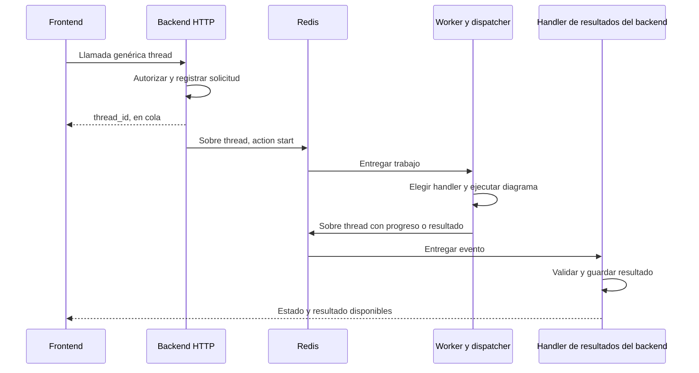
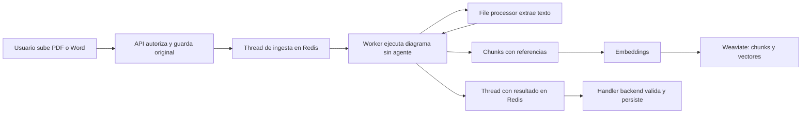
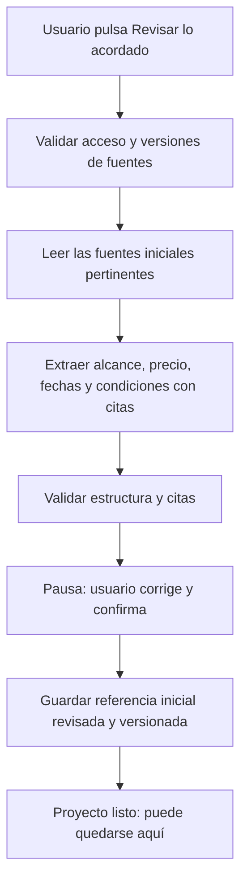
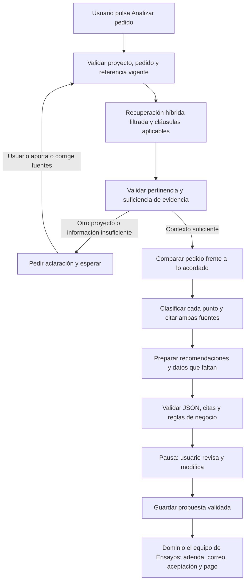

# IA de Trato: ingesta, recuperación y revisión humana

## Decisión de almacenamiento de grafos — 26 de octubre de 2026

el equipo eligió **Neo4j AuraDB Free** para el grafo de conocimiento de Trato. Se usarán tanto Neo4j como Weaviate: Neo4j para relaciones y recorridos de evidencia; Weaviate para chunks y recuperación híbrida; Supabase permanece como fuente de verdad de registros y estados de negocio. Community Edition no es la opción elegida para este bloque.

Esta decisión no crea una instancia ni confirma conexión, cuota disponible o sincronización. El siguiente trabajo consiste en definir nodos/relaciones y la proyección desde registros autorizados de Supabase, conservando los IDs, la procedencia y el aislamiento por propietario/proyecto. Aura será propio de Trato; no se reutilizan recursos de otros proyectos.

Propuesta del 25 de octubre de 2026. Documento de diseño; no habilita servicios, facturación, modelos ni migraciones.

Actualización del 26 de octubre: la primera ingesta está implementada como prueba aislada con LangGraph y Redis, extracción/pertinencia simuladas explícitamente. Ver [alcance y ejecución](worker-ingesta-documento.md). Los demás recorridos de este documento siguen siendo diseño.

Actualización posterior del mismo día: [la ingesta PDF conectada](ingesta-conectada.md) ya usa outbox, Redis, worker y extracción real. La simulación del contrato corresponde a Gemini/Vertex; la pertinencia real, recuperación e inferencia siguen pendientes. Los ciclos de cambios simulados se describen en [worker-flujo-cambios.md](worker-flujo-cambios.md).

## Resultado que debe cerrar este bloque

Con fuentes reales de un proyecto, el usuario revisa el acuerdo inicial. Después guarda un pedido nuevo y obtiene una comparación citada, datos que faltan y una propuesta editable. Al validarla, la API entrega una propuesta revisada al dominio de adendas de el equipo de Ensayos. El agente no acepta contratos, no envía correos y no ejecuta pagos.

La carga de documentos no inicia automáticamente la revisión del acuerdo ni el análisis de pedidos. El usuario conserva el control del recorrido.

## Contrato genérico thread y ejecución en worker

Aclaración de arquitectura acordada con el equipo: **worker ejecuta todos los diagramas, tanto deterministas como con agente**. La API HTTP no ejecuta grafos ni espera a extracción/inferencia. Una única llamada genérica y un sobre de evento `thread` sirven a distintos trabajos; no se crea una clase de evento por cada workflow.

El sobre mantiene un discriminador explícito `workflow` y una acción `action`. Los campos presentes en `payload` se validan según el workflow, pero no se adivina el handler por combinaciones de campos ausentes/presentes. Un pedido y una ingesta pueden contener ambos `document_id`; inferir el tipo a partir de eso sería ambiguo.

Ejemplo de contrato propuesto, todavía no implementado:

```json
{
  "type": "thread",
  "schema_version": 1,
  "thread_id": "uuid-de-ejecucion",
  "event_id": "uuid-de-evento",
  "action": "start",
  "workflow": "analyze_change",
  "context": {
    "owner_id": "derivado-de-la-sesion-por-la-api",
    "client_id": "validado-por-la-api",
    "project_id": "validado-por-la-api"
  },
  "payload": {
    "request_document_id": "uuid",
    "baseline_revision_id": "uuid"
  }
}
```

Otros workflows del mismo sobre: `ingest_document` y `prepare_baseline`. Las acciones de control incluyen iniciar y reanudar; los resultados usan progreso, espera de revisión, completado o error. Una tabla de handlers permitidos en el worker resuelve `workflow` a una función/grafo conocido. No se ejecutan nombres de módulos o funciones arbitrarias llegados en un mensaje.

El `thread_id` conserva la continuidad y se enlaza al checkpoint de LangGraph; `event_id` identifica cada mensaje para deduplicar. Reintentar la misma orden no crea una segunda ejecución. Identidad, permisos, workflow y versiones se validan al iniciar y al reanudar. El contexto de propietario se construye en backend y no se confía en campos de identidad enviados por el navegador o por el modelo.



La publicación real debe usar outbox: registrar solicitud y pendiente de publicación en la misma transacción; un relay liviano publica en Redis. El diagrama simplifica ese relay. El handler de resultados pertenece al backend, pero corre como consumidor separado de los procesos HTTP. Sólo actualiza estado/valida resultados; no vuelve a ejecutar el grafo.

Propuesta de transporte: Redis Streams con consumidores y confirmaciones, en dos streams `thread:commands` y `thread:events`. Ambos llevan el mismo sobre genérico `thread`: separar dirección evita que el backend consuma trabajos destinados al worker. Redis Pub/Sub básico no debe ser la única cola, porque puede perder mensajes si el consumidor está desconectado. Configurar persistencia/retención, consumidores pendientes y recuperación; Streams por sí solo no garantiza que sobreviva cualquier fallo. Las entregas pueden repetirse: efectos y resultados deben ser idempotentes, no suponer exactly-once.

Los mensajes contienen referencias acotadas, no PDFs, credenciales ni historiales completos. Resultados grandes y checkpoints se persisten y el evento lleva su referencia. Ante error se conserva el estado y se informa; no se elige otro proveedor ni una simulación automáticamente.

## Responsabilidades de los repositorios

Decisión posterior del 28/10: las herramientas de archivos solicitadas por un agente seguirán **worker → backend → file processor → backend → worker**. El worker ejecuta el diagrama y las llamadas al modelo; el backend autoriza y canaliza; el procesador ejecuta la función de archivos. Contrato y diferencias con el código actual en [herramientas-archivos-agentes.md](herramientas-archivos-agentes.md). Es arquitectura objetivo: no afirma una refactorización ya terminada.

Actualización 28/10: para las fuentes del evaluador de Ensayos se investigó [contexto directo frente a recuperación](fuentes-y-recuperacion-ensayos.md). La propuesta combina rúbrica breve siempre presente y recuperación para una biblioteca ampliada. No obliga a buscar en Weaviate cada regla esencial, no cambia este diseño de indexación y no confirma que el índice esté implementado.

| Componente | Responsabilidad |
| --- | --- |
| trato-web / interfaz local actual | Subir fuentes, mostrar progreso, revisar/corregir resultados y continuar explícitamente. |
| trato-api | Recibir thread, autenticar/autorizar, registrar/publicar órdenes y validar decisiones humanas. Su handler de eventos persiste resultados y aplica reglas de negocio. |
| trato-file-processor | Leer PDF/DOCX y producir texto y localizadores. No interpreta acuerdos ni usa el LLM. |
| trato-worker | Consumir thread, despachar handlers y ejecutar TODOS los diagramas, con IA o sin IA. Coordinar extracción, fragmentación, indexación, recuperación y análisis; emitir progreso/resultados. |
| LangChain dentro del worker | Adaptador del modelo, prompts, recuperación y salida estructurada. No es otro microservicio. |
| Supabase existente | Fuente de verdad de identidad, relaciones, documentos privados y resultados revisados. |
| Weaviate | Proyección de búsqueda: fragmentos y vectores reconstruibles; nunca autoridad sobre aceptación o pago. |
| Modelo generativo | Interpretar fuentes y recomendar con citas; backend valida su salida. |

Hay ya un worker con interfaz de modelo y validación literal de citas. Su adaptador actual es Ollama explícito; no se ha conectado inferencia real. El recorrido LangGraph local anterior es simulado y no se utilizará como respaldo del funcionamiento conectado.

## Ingesta e índice



El vector sirve para encontrar fragmentos relacionados por significado. El LLM interpreta esos fragmentos junto con las fuentes aplicables. Subir un documento no lo convierte en acuerdo aceptado.

Cada fragmento lleva referencias normalizadas: `owner_id`, `client_id`, `project_id`, `document_id`, `document_version_id`, `segment_ids`, `chunk_id`, localizadores, tipo de fuente, hash del contenido, modelo/revisión/dimensión de embeddings y versión del proceso de fragmentación. Los campos de permisos y pertenencia se derivan en servidor; el modelo no puede decidirlos.

La ingesta debe ser idempotente por versión/hash/configuración de fragmentación/embeddings. Una versión nueva no sobrescribe los fragmentos de otra; un documento eliminado deja de ser recuperable. Antes de usar un resultado se comprueba en Postgres que la fuente sigue autorizada y corresponde a la versión solicitada.

## Grafo A: acuerdo inicial



El file processor lee el original una vez por versión durante la ingesta. Después, el agente consulta chunks en Weaviate: no se adjunta el documento completo por defecto a cada petición del modelo. Para organizar el acuerdo inicial se hacen consultas específicas de alcance, precio, plazos, exclusiones y condiciones; el contexto se acota y conserva citas. Si la recuperación no aporta suficiente evidencia, se pide aclaración; un fragmento ausente del top-k no demuestra que una cláusula no exista.

Revisar la referencia inicial no equivale a obtener una firma del cliente. La referencia inicial tiene identidad y versión propias; su relación con el dominio de aceptación de el equipo de Ensayos se debe acordar antes de implementarla.

## Grafo B: pedido nuevo



Las categorías son: incluido, posible adicional, contradictorio o ambiguo. Un documento ajeno al proyecto no pasa a recomendaciones. Si falta tarifa, esfuerzo estimado, disponibilidad o materiales, el sistema lo indica y solicita esos datos. No se inventan cifras para completar una tarjeta de precio. Los importes se calculan fuera del LLM con entradas explícitas del profesional.

Las pausas humanas se modelan con interrupts y checkpoints durables de LangGraph. Al reanudar se vuelve a comprobar autorización y la versión de referencia; si cambió el acuerdo mientras se analizaba, el resultado debe revisarse sobre la nueva referencia. Los checkpoints no son versiones de adenda ni registros de firma/pago. [Persistencia y revisión humana de LangGraph](https://docs.langchain.com/oss/python/langgraph/interrupts).

## Recuperación híbrida sobre chunks

Configuración inicial propuesta por el equipo: **70% vectorial y 30% léxica BM25**, mediante `alpha=0.7` en Weaviate. Usar fusión de puntuaciones normalizadas (por ejemplo `relativeScoreFusion`), no promediar directamente distancia vectorial y puntuación BM25 de escalas distintas. Se evaluará esa ponderación con documentos en español, identificadores y cláusulas reales; es un punto de partida, no un óptimo garantizado.

Cada búsqueda impone propietario/tenant, cliente, proyecto y versiones aplicables en la consulta al índice, antes de elegir el conjunto relevante. No hacer top-k global y descartar otros clientes después: eso desperdicia resultados y mezcla candidatos ajenos. El LLM recibe los chunks pertinentes y la referencia estructurada revisada; puede recuperar contexto adicional del mismo ámbito cuando una cita lo requiera. Las claves administrativas permanecen en servicios internos.

## Aislamiento en la recuperación

- El worker recibe un contexto autorizado por la API, no IDs elegidos por el LLM.
- Una colección de fragmentos; tenant por propietario para la primera configuración, y filtros obligatorios de cliente/proyecto/versiones dentro del tenant. El límite de tenants afecta propietarios aislados, no implica tres proyectos máximos.
- El servidor impone los filtros en búsqueda híbrida, consultas directas y reanudación. El navegador no recibe la clave administrativa de Weaviate.
- No se considera suficiente el aislamiento del índice: cada cita se valida de nuevo contra documentos/segmentos autorizados en la fuente de verdad.
- Los documentos son datos; una instrucción incrustada en un PDF/correo no concede permisos ni activa herramientas.

Weaviate documenta el aislamiento entre tenants; debe habilitarse al crear la colección. [Multi-tenancy](https://docs.weaviate.io/weaviate/manage-collections/multi-tenancy).

## Proveedores y costos: verificado en documentación pública

Google Cloud anuncia USD 300 de bienvenida durante 90 días para clientes elegibles. No equivale a crédito canjeable en cualquier API: la documentación actual excluye Gemini API de AI Studio de ese crédito, y excluye modelos generativos de terceros ofrecidos como API administrada. [Programa de Google Cloud](https://docs.cloud.google.com/free/docs/free-cloud-features), [facturación de Gemini API](https://ai.google.dev/gemini-api/docs/billing).

Ruta candidata: Gemini mediante el backend de Google Cloud/Vertex AI que corresponda al proyecto y a la oferta disponible. Antes de conectarlo hay que comprobar crédito activo, vencimiento, producto/SKU elegible, región, cuotas y modelo accesible en esa cuenta. No se ha consultado la cuenta de el equipo ni se garantiza cobertura de un modelo concreto. Elegir proveedor/backend explícitamente; no usar autodetección que pueda cambiar al canal de AI Studio. [Integración de Google en LangChain](https://docs.langchain.com/oss/python/integrations/chat/google_generative_ai).

Weaviate anuncia actualmente plan Free permanente, sin tarjeta: una colección, hasta 100.000 objetos y tres tenants; la página también indica 1 GB de memoria y 10 GB de disco. Es una opción concreta para la demo, sujeta a disponibilidad de alta y límites vigentes. No dimensionar producción suponiendo una prueba temporal ni almacenamiento infinito. [Precios de Weaviate](https://weaviate.io/pricing).

El proveedor de embeddings se elige por separado del LLM y se fija su versión. Cambiarlo exige reindexación y evaluación; no se mezclan vectores incompatibles. Su costo/cuota y calidad en español se verifican antes de adoptarlo. No se decidió contratar embeddings ni Query Agent de Weaviate por el hecho de usar su base de vectores.

Si un proveedor falla o se acaba su cuota, se conserva el trabajo y se muestra el error; no se activa Ollama, otro proveedor, otro índice o una simulación automáticamente.

## Contrato propuesto para la integración con el equipo de Ensayos

Todavía no son rutas ni DTO implementados. El acuerdo de contrato debe preceder a nuevas migraciones compartidas.

- Referencia revisada: identidad/versión, fuentes exactas, alcance y condiciones confirmadas, precio/moneda/fecha conocidos o ausentes explícitamente, autor y momento de revisión.
- Ejecución de análisis: `run_id`, proyecto/pedido y versión de referencia, estado técnico, modelo/prompt/schema utilizados y consumo registrado. Su estado técnico no se añade a los estados de negocio de pagos.
- Resultado: lista de puntos del pedido, clasificación, comparación, citas exactas por punto, preguntas pendientes y recomendaciones editables. Sin evidencias de aceptación o pago.
- Cada cita: documento/versión/segmento/localizador y texto literal. Se valida tanto pertenencia como literalidad; esto no garantiza por sí solo que la interpretación semántica sea correcta.
- Traspaso al dominio: solo los datos revisados por el usuario, con trazabilidad al análisis y a la versión de base. el equipo de Ensayos conserva revisiones/PDFs/aceptaciones/pagos autoritativos.
- Los datos centrales se normalizan en tablas con relaciones. Metadatos adicionales van en extensiones versionadas; no convertir todo el contrato en un JSON libre ni añadir campos sensibles decididos por el modelo.

## Orden del trabajo

1. Acordar referencia inicial y DTO de análisis con el equipo de Ensayos; fijar casos de evaluación en español.
2. Comprobar Google Cloud y el alta gratuita de Weaviate; elegir modelos explícitos sin habilitar consumo todavía.
3. Ingesta e índice trazables con pruebas de aislamiento y recuperación de cláusulas.
4. Conectar inferencia real y ambos grafos, persistencia y revisión humana.
5. Integrar resultados en la interfaz local y entregar la propuesta revisada al dominio de el equipo de Ensayos.

Criterios de cierre: análisis real con citas verificadas o aclaración explícita, no mezcla entre proyectos, no precios inventados, reanudación tras reinicio sin duplicar efectos y validación humana antes del traspaso. El caso sin pedido termina correctamente al guardar la referencia inicial.

## Fuentes adicionales de esta aclaración

- [Redis Pub/Sub: semántica de entrega](https://redis.io/docs/latest/develop/pubsub/)
- [Redis XREADGROUP: consumidores de streams](https://redis.io/docs/latest/commands/xreadgroup/)
- [Weaviate: búsqueda híbrida y alpha](https://docs.weaviate.io/weaviate/search/hybrid)
- [LangGraph: persistencia por thread](https://docs.langchain.com/oss/python/langgraph/persistence)
