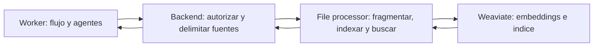

# Busqueda vectorial y fuentes: estado integrado

1 noviembre 2026. Lote local, sin publicar. El procesamiento por proposito esta conectado por trabajo y activacion explicita; no implica que todos los productores de documentos de otros modulos esten conectados.

## Responsabilidades y conexion

El worker orquesta a los agentes y solicita herramientas al backend. El backend verifica usuario, propietario, cliente, proyecto y fuentes vigentes. El file processor ejecuta las operaciones de archivos, embeddings, escritura y busqueda en Weaviate. El resultado vuelve al backend, que comprueba texto, offsets y procedencia antes de entregarlo. Las claves y SDK de Weaviate existen exclusivamente en el procesador.

Las rutas de consulta de documentos de proyecto ya estan disponibles en el backend autenticado. El futuro asistente por proyecto debera invocarlas mediante herramientas autorizadas de su trabajo, sin enviar el JWT del usuario al modelo ni dejarle escoger propietario/tenant. Crear estas rutas no habilita por si solo ese nuevo chat ni un catalogo universal de herramientas.

## Almacenamiento y aislamiento

Coleccion unica `TratoSourceChunks`, modelo fijo `Snowflake/snowflake-arctic-embed-l-v2.0`, 1024 dimensiones, coseno. El cluster Free rechazo HNSW con CONFIG_NOT_ALLOWED: requiere HFresh; se configuro HFresh explicitamente. No existe seleccion automatica de otro indice, modelo o proveedor ante un fallo. El cliente Python fijado es weaviate-client4.24.1, con consultas gRPC; no se incorpora la API GraphQL deprecada.

Dos tenants creados: `projects_private` y `reputation_public`. El tercero permanece libre. El primero comparte almacenamiento entre usuarios, pero toda operacion privada exige filtros owner/client/project y archivo/generacion autorizados. Se revalida contra Supabase antes y despues de la busqueda. Las claves administrativas de desarrollo permiten acceso directo al cluster completo; no equivalen al acceso restringido del agente.

El tenant de reputacion recibe exclusivamente textos de experiencias publicadas. El backend obtiene la seleccion vigente de Supabase y el procesador escribe con IDs comunitarios y version; no incluye propietario, proyecto, contratos ni adjuntos privados. Un outbox transaccional en Supabase registra publicaciones, cambios y retiradas. El worker solicita sincronizacion al backend, que delega escritura y limpieza al procesador. Los recibos y generaciones se comparten en Supabase entre instalaciones. Una retirada o edicion bloquea consultas obsoletas inmediatamente, aunque la limpieza fisica siga pendiente. Una limpieza fallida conserva error visible.

Rutas autenticadas adicionales: POST `/api/v1/reputation/clients/{profile_id}/sources/sync` y `/sources/search`. La sincronizacion de experiencias anteriores es explicita; no hay backfill masivo implicito. La IA de Reputacion conserva su lectura autorizada de experiencias completas; este indice no convierte un top-k en prueba exhaustiva.

## Operaciones implementadas

| API autenticada | Funcion |
| --- | --- |
| GET /api/v1/projects/{project_id}/sources | Inventario completo, paginado, con estados y generaciones; no es un top-k |
| POST /api/v1/projects/{project_id}/documents/{file_id}/index | Indexacion explicita del texto ya extraido de ese documento |
| POST /api/v1/projects/{project_id}/sources/search | Consulta hibrida sobre los documentos vigentes del proyecto |

El procesador expone `/v1/files/chunks`, `/v1/vectors/index` y `/v1/vectors/search`, con su credencial interna, esquemas estrictos y limites de entrada. No acepta una consulta Weaviate arbitraria ni un tenant elegido por el llamador. El backend nunca envia el original PDF a Weaviate: usa los segmentos extraidos y guardados en Supabase, y solicita al procesador fragmentos con localizadores.

Chunks800caracteres, solapamiento100, maximo512 y4096bytes por fragmento. El backend valida cobertura de todos los caracteres materiales, IDs, hashes, offsets y texto exacto. Solo chunk_text se vectoriza y participa en BM25; los metadatos no sesgan el embedding. La busqueda usa alpha0.7 y relativeScoreFusion. Es la ponderacion inicial acordada, no una precision medida para todos los casos.

Las escrituras usan IDs deterministas por contenido y generacion. El procesador comprueba todos los objetos y vectores antes de devolver confirmacion. El backend conserva un recibo de proyeccion en Redis propio con AOF; solo activa una generacion completa y vigente. Un fallo parcial deja la fuente pendiente/erronea, sin presentarla como indice listo. Reintentar es explicito y conserva los mismos IDs. No se borra una generacion anterior automaticamente para fingir capacidad disponible.

El indice tiene una reserva conservadora de1000objetos por debajo del maximo100000. Cuenta objetos reales, incluidas generaciones antiguas/parciales. La API serializa las escrituras en su Redis y el procesador evita escrituras simultaneas en su proceso. Instalaciones locales distintas no comparten esos locks: la cuota dura del proveedor y los errores de lote siguen siendo el ultimo control entre instalaciones; no se promete una reserva distribuida global. Una futura ejecucion distribuida necesita un ledger comun antes de prometerla.

Un documento extraido no implica firma, aceptacion ni pago. El resultado de busqueda devuelve citas a paginas/segmentos y ruta autenticada del original; no modifica el acuerdo ni decide estados PayPal. Un top-k vacio tampoco prueba que una clausula no exista.

## Fuentes del evaluador

Ensayos conserva sus cinco fuentes obligatorias completas, sin pasar por top-k: escucha activa MIT, negociacion por intereses PON, resumen de conversaciones dificiles Ohio State, seleccion Commitment/Conclusion de Slavik y microhabilidades de Patton/PON. Se conserva la seleccion limitada de Slavik y la exclusion del apartado5f. Biblioteca privada y localizadores segun `fuentes-evaluador-ensayos.md`.

La herramienta sigue worker→backend→procesador→backend→worker. Se comprueban manifiesto, archivos permitidos, hashes y lectura de las cinco antes de llamar al evaluador. El host resuelve las referencias a citas literales, valida evidencia de cada turno y limita las palabras citadas. El resultado ahora conserva el catalogo de guias leidas y distingue cuales fueron citadas; la interfaz muestra atribucion, fundamento y enlace original. El modelo no inventa URLs ni autores. Una cita literal correcta no garantiza por si sola la interpretacion: la calidad con Gemini se validara en la prueba conjunta.

## Comprobaciones realizadas

- Suites de contratos API, procesador y worker; aislamiento, entrada estricta, falta de cobertura, datos alterados, generacion obsoleta y fallo parcial.
- Recorrido API→procesador por HTTP en proceso, usando funciones reales de fragmentacion/rutas y doble del proveedor. No es una sesion de usuario real.
- Clúster real: se escribio un fragmento sintetico y se recupero exactamente por busqueda hibrida. Cambiar propietario o proyecto no recupero ese objeto. Se elimino y se confirmo su eliminacion. No se enviaron documentos de usuarios ni se llamo a Gemini en esta comprobacion.
- Herramienta de fuentes HTTP: cinco guias,26393bytes de texto y547referencias extractivas; sin llamada al modelo. `scripts/check-rehearsal-sources.py` permite repetir esta comprobacion tecnica.

No se ha probado la interfaz ni una conversacion/evaluacion real completa de Gemini en este lote. El recorrido `process_file` ya conecta autorizacion de trabajo/lease, lectura preparada por el procesador, tratamiento, fragmentos, resumen con citas, indice y resultado. Los artefactos inmutables se guardan en Supabase; solo los fragmentos se vectorizan. La fuente y su contexto se revalidan antes de aceptar resultados. API y worker requieren `TRATO_FILE_PROCESSING_ENABLED=true`; la activacion local completa y las pruebas con documentos/modelos reales quedan pendientes de la prueba conjunta.

Productores conectados: acuerdo inicial, pedido de cambio, referencias, entregas, feedback de una revision, PDF generado de adenda y PDF devuelto. La lectura no formaliza acuerdos ni verifica firmas, pagos o devoluciones. Los handlers de devoluciones y evidencia estan registrados y exigen un pago confirmado, pero el dominio de casos de Flores aun no esta enlazado; no inventar IDs ni afirmar conectado su flujo. Los adjuntos privados de reputacion tampoco se publican o indexan por esta entrega.

Ver `configuracion-vectorial-colaboradores.md` antes de actualizar otra instalacion.

Referencias oficiales consultadas: [embeddings](https://docs.weaviate.io/weaviate/model-providers/weaviate/embeddings), [busqueda hibrida](https://docs.weaviate.io/weaviate/search/hybrid), [multi-tenancy](https://docs.weaviate.io/weaviate/manage-collections/multi-tenancy), [limites Free](https://weaviate.io/pricing). No cambiar la cuenta a un plan de pago como alternativa ante cuota o fallo.

## Enlace automatico posterior a la extraccion

Tras confirmar la extraccion canonica en Supabase, thread_runner encola index_document con ID determinista por propietario/archivo/generacion. Si el enqueue falla, conserva el evento sin ACK: redelivery confirma el resultado ya persistido y reintenta el mismo enqueue idempotente, no la inferencia. El worker consume ese trabajo sin llamar aGemini, solicita /internal/vector-jobs/{id}/execute con su credencial y execution_id vigente; el backend toma scope del trabajo almacenado, revalida proyecto/cliente/archivo y solicita escritura alFP. No acepta scopes libres del worker. Las finalizaciones del worker comparan execution_id y estado running, evitando resucitar trabajos interrumpidos.

Un fallo de indexacion conserva error visible en el recibo/inventario y no se reintenta automaticamente como si fuera un exito. Extraccionready e indexready son estados diferentes. Fuentes ya existentes pueden indexarse mediante la accion explicita; no se inicia una reindexacion masiva silenciosa al arrancar. Ejecutar `scripts/dev-polyrepo.py --with-worker` para el recorrido completo; `--with-ai` no inicia ingesta/pump y se conserva durante la preparacion actual para no drenar trabajos del usuario antes de su prueba.

## Verificacion de cierre, 1 noviembre 2026

API: 239 pruebas correctas. Worker: 128 ejecutadas, 11 omitidas explicitamente; las restantes correctas. Procesador: 26 correctas. Incluyen recorrido LangGraph/herramientas/backend/procesador con modelos y almacenamiento de prueba, citas literales, aislamiento, generaciones, retirada y fallos. El esquema real compartido se actualizo y valido sin inferencia. Estas pruebas no acreditan calidad de Gemini ni E2E desde navegador. Lote local, sin publicar.
