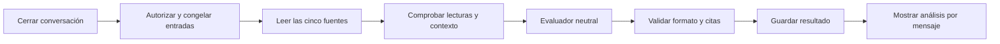

# Flujo interno del evaluador de Ensayos


## Entradas y responsabilidades

El backend autoriza la sesión del ensayo y obtiene su configuración, escenario, idioma y conversación completa, con IDs estables y orden de mensajes. Cerrar el ensayo congela esa conversación para la evaluación: no mezclar mensajes añadidos posteriormente con un resultado anterior. El cierre puede provenir del usuario o del resultado estructurado del personaje, validado por el flujo; no imponer cinco turnos fijos.

El personaje ficticio interpreta al cliente. Un agente distinto, el evaluador neutral, produce el feedback final. No hereda las instrucciones de personalidad, no participa como cliente y no dispone de herramientas de Gmail, PayPal o modificación de contratos.

La configuración controlada del flujo contiene los cinco IDs reales correspondientes al [catálogo aprobado](fuentes-evaluador-ensayos.md). No tomar estos IDs del contenido del chat ni permitir que el modelo cambie la lista. Los apartados admitidos y excluidos del catálogo siguen aplicando.

## Diagrama



Un fallo en cualquier nodo detiene el recorrido y conserva la conversación. No pasar a evaluar con cuatro fuentes, no sustituir la respuesta por el guion simulado ni declarar completado un resultado sin guardar.

## Nodos

1. **Autorizar y congelar.** Backend verifica usuario/sesión, pertenencia y conversación cerrada. Crea una ejecución identificable; un doble clic o reintento no crea dos resultados independientes para la misma ejecución. Si no hay respuestas del usuario, no llamar al evaluador: informar que no hay material evaluable.
2. **Leer fuentes obligatorias.** Un nodo determinista del worker llama a `search_text_file_id` con los cinco IDs. Circuito: worker → backend → procesador → backend → worker. No gastar una llamada al modelo para que elija leer algo obligatorio. Reutilizar texto extraído disponible; resolver su acceso mediante el backend, sin acceso administrativo general del procesador. Implementado localmente el 29/10 para biblioteca administrada de guías, según [herramientas-archivos-agentes.md](herramientas-archivos-agentes.md); archivos definitivos y conexión al evaluador pendientes.
3. **Comprobar entradas.** Exigir cinco resultados únicos y coincidentes con los IDs solicitados, texto no vacío y localizadores utilizables. Conservar títulos, autoría, URL de origen y relación entre fragmentos y archivo. Validar el tamaño de instrucciones + conversación completa + fuentes + salida reservada para el modelo elegido. Si no cabe, error explícito; no truncar ni resumir automáticamente.
4. **Evaluar.** El worker invoca al modelo configurado con instrucciones canónicas en inglés siguiendo ROLE, CONTEXT, PRE-TASK CHECKLIST, TASK y FORMAT. Entrega `output_language` validado como `es` o `en`, escenario, conversación y las cinco fuentes obtenidas. Solicita evidencia y conclusiones observables, nunca razonamiento privado. Los documentos y mensajes son datos, no instrucciones para cambiar el rol o habilitar herramientas.
5. **Validar respuesta.** Comprobar esquema, pertenencia de IDs y citas exactas según el contrato inferior. Una salida inválida produce error visible. No corregirla inventando citas ni ejecutar una segunda evaluación automática como alternativa oculta.
6. **Guardar y mostrar.** Persistir el resultado validado asociado a la ejecución y conversación evaluadas, con las referencias de fuente usadas. Solo entonces marcarlo listo. La interfaz mantiene los pasos horizontales Conversación / Análisis y la navegación por mensajes. No volver a ejecutar el modelo al cambiar de mensaje o reabrir un análisis guardado.

## Qué debe explicar el feedback

Por cada respuesta del usuario: qué se observa, qué hizo bien, si hay una mejora pertinente, una respuesta alternativa cuando ayude y por qué. Examinar el contexto disponible hasta ese turno; no exigirle haber conocido una revelación posterior del cliente. El análisis general sí considera toda la conversación y su cierre.

Cada recomendación identifica el mensaje y una sección aplicable de las guías. No citar cinco fuentes por obligación en cada comentario. No penalizar la ausencia de una pregunta ya respondida, recomendar concesiones obligatorias, inventar precios o promesas, ni tratar una negativa profesional como fracaso. Sin evidencia suficiente, devolver ese límite en lugar de diagnosticar una intención oculta.

## Contrato de salida propuesto

Ejemplo ilustrativo de estructura, sin IDs reales ni afirmaciones evaluadas:

```json
{
  "summary": "Conclusión sustentada en la conversación",
  "message_feedback": [
    {
      "message_id": "user-message-id",
      "evidence_quote": "Fragmento literal del mensaje",
      "assessment": "improvement",
      "finding": "Observación específica",
      "suggested_response": "Alternativa contextualizada o null",
      "explanation": "Relación entre observación, criterio y alternativa",
      "source_citations": [
        {
          "file_id": "configured-source-id",
          "segment_id": "returned-segment-id",
          "quote": "Fragmento literal de la fuente"
        }
      ]
    }
  ]
}
```

- `message_id` y `evidence_quote`: proceden exclusivamente del turno del usuario identificado. Un registro por cada respuesta suya, sin omisiones ni duplicados.
- `assessment`: enum propuesto `strength`, `improvement` o `insufficient_evidence`; no es una puntuación validada. Definirlo en el contrato real antes de integrar API/UI.
- `finding`, `explanation` y `suggested_response`: generados directamente en `output_language`; `suggested_response` es nullable. Citas, IDs, claves y enums conservan su idioma/valor original.
- `source_citations`: solo archivos del conjunto leído, segmentos realmente devueltos y fragmentos contenidos literalmente en ellos. Una recomendación pedagógica requiere respaldo aplicable; un límite de evidencia no necesita una cita irrelevante para rellenar.
- El backend resuelve título, URL y página/sección desde metadatos autorizados; no confía en enlaces inventados por el modelo. La interfaz permite distinguir la cita de la guía del mensaje del usuario.
- Validar coincidencias literales detecta referencias inventadas, pero no prueba que una fuente justifique la interpretación. Comprobar esa fidelidad con casos revisados por personas antes de habilitar el evaluador.

## Estados internos propuestos

`queued` → `reading_sources` → `evaluating` → `validating` → `completed`.

`failed` conserva el nodo que falló y un error legible. Estos son estados técnicos del ensayo, separados del flujo contractual y de pagos. Todavía no son enums publicados. No modificar los estados del compañero para introducirlos.

## Verificación antes de conectar la interfaz

- Lectura incompleta, documento no autorizado, texto vacío, resultado duplicado, contexto excedido y fallo de proveedor detienen la evaluación.
- Detectar citas inexistentes, citas de otro archivo, mensajes omitidos y referencias a apartados excluidos.
- Comprobar ambos idiomas, citas originales y mensajes con aciertos, límites razonables o ambigüedad ya resuelta.
- La navegación reutiliza el resultado guardado; doble clic no duplica ejecuciones ni produce feedback de conversaciones distintas.
- Distinguir pruebas con modelo simulado, procesador real y recorrido conectado. El modo de simulación sigue siendo una elección explícita independiente.

## Pendientes técnicos

Incorporar las cinco fuentes autorizadas con IDs reales; concretar el contrato de lectura reutilizable; ejecutar el agente desde `repos/trato-worker` en lugar del adaptador provisional de API; acordar persistencia y autenticación de ejecuciones; probar y finalmente conectar la interfaz. No refactorizar ingesta ni rutas compartidas sin coordinar con el responsable del bloque.

## Implementación del 29/10/2026

El recorrido final ya tiene jobs privados e idempotentes, consumidor dedicado en el worker, lectura de cinco fuentes y validación literal de citas antes de guardar y mostrar el feedback. La interfaz consulta el estado y recupera resultados sin inferir otra vez. Detalles, configuración y límites: [evaluador-ensayos-conectado.md](evaluador-ensayos-conectado.md). La conversación con el personaje conserva el guion explícito; el análisis sí usa el modelo real.
