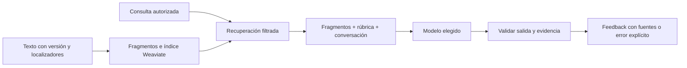

# Fuentes de Ensayos: contexto directo y recuperación

Investigación del 28/10/2026 solicitada por Sebastian. Propuesta de arquitectura; no instala Weaviate, no cambia proveedor, no activa inferencia ni modifica el recorrido contractual del compañero. Rama compartida: `feature/trato-next-iteration`.

## Qué significa responder teniendo en cuenta una fuente

Hay dos operaciones distintas: obtener información pertinente y generar una respuesta a partir de ella. Guardar documentos no hace que un modelo los consulte. El backend debe seleccionar contenido autorizado y entregarlo en la petición; después debe validar qué utilizó la respuesta.

La documentación de [AWS Knowledge Bases](https://docs.aws.amazon.com/bedrock/latest/userguide/knowledge-base.html) presenta RAG como recuperación de información que complementa el prompt y admite citas. Es una referencia industrial de arquitectura, no una propuesta de contratar AWS para Trato.

## Las opciones no se excluyen

| Opción | Cuándo explorarla | Límite |
| --- | --- | --- |
| Texto seleccionado directamente en contexto | Rúbrica corta, acuerdo concreto y conversación del ensayo | El contexto tiene límite; no enviar contenido irrelevante o infinito. |
| PDF al modelo que lo soporte | Lectura visual de tablas, imágenes o formato | Depende del proveedor y sus capacidades; conservar citas/localizadores verificables. |
| Recuperación en Weaviate | Muchas fuentes, versiones o necesidad de localizar fragmentos | Encontrar texto parecido no prueba que sea suficiente, vigente o aplicable. |

[Gemini admite PDFs](https://ai.google.dev/gemini-api/docs/document-processing), incluso su contenido visual, por datos inline o Files API. Adjuntar un archivo depende de esa integración concreta; pegar un enlace no hace que nuestro adaptador lo lea. El adaptador Qwen actual de Trato envía mensajes de texto: necesita extracción previa, no recibe un PDF binario.

El procesador existente ya produce texto y localizadores de documentos. Reutilizar ese resultado por versión, sin volver a leer el original en cada turno. No cambiar esta ingesta ni el flujo del compañero para implementar esta propuesta.

## Qué haría Weaviate

El patrón documentado por [Weaviate RAG](https://docs.weaviate.io/weaviate/search/generative) es buscar primero y entregar resultados junto al prompt al generador. En Trato podemos hacer esa recuperación desde el backend/worker y conservar el adaptador de modelo explícito, sin delegar la selección de proveedor a Weaviate.

Su [búsqueda híbrida](https://docs.weaviate.io/weaviate/search/hybrid) combina similitud vectorial y palabras clave BM25F. Los embeddings representan significado para buscar; no reemplazan el texto original ni acreditan una afirmación. Necesitamos modelo de embeddings explícito y compatible para indexación/consulta. La ponderación del plan existente es una hipótesis por evaluar, no una precisión garantizada.

## Propuesta específica para Ensayos

1. **Instrucciones:** comportamiento, idioma, límites y formato, únicos en inglés; `output_language` validado.
2. **Rúbrica obligatoria:** criterios breves, revisados y versionados que siempre recibe el evaluador. No depender del top-k para recordar reglas esenciales.
3. **Caso y conversación:** fuentes del ensayo seleccionado, historial y mensaje que se evalúa. Distinguir las palabras del usuario de los consejos de una guía.
4. **Biblioteca ampliada:** Weaviate cuando haya un corpus que justifique recuperación; fragmentos de guías pertinentes con referencia a documento, versión y página/sección.
5. **Comprobación:** evidencia literal del mensaje, criterio aplicado, fuente de respaldo y límites. Una guía de negociación no prueba lo pactado con un cliente.

Es una composición explícita, no un fallback. No desplegar un índice para dos guías pequeñas solo por añadir tecnología, ni descartar Weaviate cuando un corpus mayor lo haga útil. Medir las dos estrategias con los mismos casos antes de elegir para cada responsabilidad. El grafo y Supabase conservan las relaciones y estados de negocio; el índice es reconstruible.

## Aislamiento y vigencia

[Weaviate multi-tenancy](https://docs.weaviate.io/weaviate/manage-collections/multi-tenancy) permite separar datos por tenant y debe habilitarse expresamente. Además, la aplicación impone pertenencia a cliente/proyecto/versión antes de recuperar y vuelve a comprobar autorizaciones en la fuente de verdad. Un filtro elegido por el modelo no sustituye permisos.

Separar biblioteca pública de formación, documentos privados del proyecto y experiencias comunitarias consentidas. Publicar una reseña no concede acceso a los contratos privados de su autor. La biblioteca puede orientar el estilo; no reemplaza un acuerdo específico ni una política PayPal aplicable. Fuentes retiradas, versiones obsoletas y documentos eliminados requieren invalidación de sus resultados.

## Qué no garantiza RAG

La investigación de [Liu, Zhang y Liang, 2023](https://arxiv.org/abs/2304.09848) evaluó buscadores generativos y encontró citas inexactas y afirmaciones sin respaldo. Sus cifras no miden Trato ni nuestros modelos. La implicación para nuestro diseño es comprobar cobertura y fidelidad, no dar por correcto un resultado por tener enlaces.

Un fragmento que no aparece en la búsqueda no demuestra que la cláusula no exista. Una cita literal válida tampoco prueba que la interpretación sea correcta. La fidelidad semántica necesita evaluación adicional. Sin evidencia suficiente: indicar el límite, pedir información o devolver un error según corresponda; no rellenar con conocimiento general como si fuera una fuente recuperada.

## Comprobaciones antes de habilitarlo

- [ ] Comparar contexto directo y recuperación con casos conocidos, sin afirmar mejora antes de medirla.
- [ ] La búsqueda trae la sección esperada; casos negativos no recuperan otros clientes o versiones.
- [ ] Cada conclusión relevante tiene respaldo y cada cita sostiene la conclusión asociada.
- [ ] Contradicción, fuente ausente, dato desactualizado y texto malicioso dentro del documento se manejan explícitamente.
- [ ] Idiomas ES/EN conservan las citas originales y el alcance de la recomendación.
- [ ] Medir tiempo, tamaño del contexto y uso de recursos; error de índice/modelo visible sin alternativa automática.

## Estado y siguiente paso

Weaviate estaba previsto en [arquitectura-ia-trato.md](arquitectura-ia-trato.md), pero la documentación de ingesta indica fragmentos sin indexación. Esta investigación no acredita un índice conectado. La rúbrica y fuentes del evaluador siguen en revisión; no se han sustituido en el código por el hecho de investigar estas opciones.

Dos fuentes de coaching revisadas: [Seven Elements of Effective Negotiations](https://hms.harvard.edu/sites/default/files/Departments/Ombuds%20Office/files/SEVEN%20ELEMENTS%20OF%20EFFECTIVE%20NEGOTIATIONS.pdf), documento de formación de 2008; y [Principled Negotiation](https://www.pon.harvard.edu/daily/negotiation-skills-daily/principled-negotiation-focus-interests-create-value/), artículo de PON. Orientan escucha, intereses y opciones; no constituyen una escala validada para freelancers. Su selección y aplicación a Trato deben documentarse como adaptación propia. La URL de escucha del adaptador no pudo verificarse en esta consulta por timeout y no se marca como revisada.

Catálogo concreto revisado: [fuentes-evaluador-ensayos.md](fuentes-evaluador-ensayos.md). La decisión posterior de Sebastian es un conjunto fijo de archivos por IDs y lectura obligatoria, según [herramientas-archivos-agentes.md](herramientas-archivos-agentes.md). No se requiere Weaviate para seleccionar esas guías ni una nueva gestión de versiones documentales. Pendientes incorporación, medición del contexto y pruebas del evaluador; no interferir con Reputación ni el recorrido contractual.

## Actualizacion de integracion, 1 noviembre 2026

La base de indexacion y consulta privada esta conectada mediante backend autenticado→file processor→Weaviate; el procesador ejecuta tanto escritura como busqueda. Se mantienen permisos y comprobacion de fuentes en el backend. Coleccion unica y tenants projects_private/reputation_public, tercero libre. Tras una extraccion nueva, el pump encola indexacion determinista para el worker; la proyeccion comunitaria y el pipeline universal por proposito siguen siendo alcance separado; no deducir que estan conectados por crear los tenants. Estado preciso, pruebas y limites en [busqueda-vectorial-conectada.md](busqueda-vectorial-conectada.md).

El evaluador conserva la lectura completa obligatoria de las cinco guias, comprobada por herramienta HTTP sin llamada al modelo. Su respuesta agrega el catalogo de fuentes realmente leidas y distingue las citadas; ninguna busqueda top-k sustituye la lectura. Queda pendiente la validacion conjunta con Gemini desde la interfaz.
