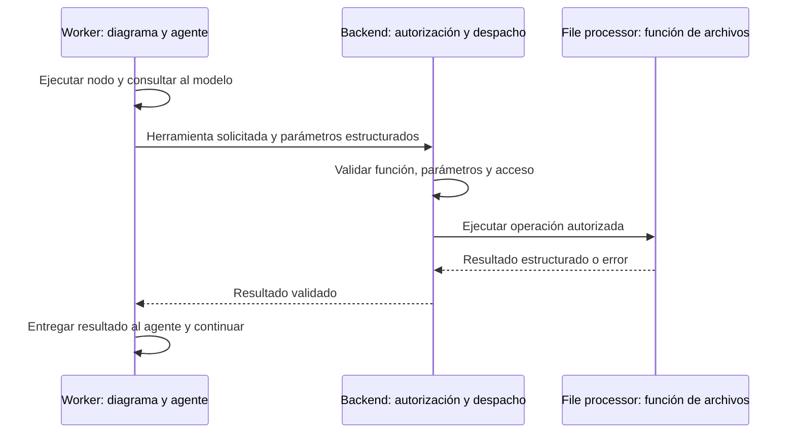

# Herramientas de archivos para agentes: arquitectura acordada

Decisión explícita de el equipo, 28/10/2026. Implementación de herramientas iniciada el 29/10/2026 en el lote compartido `feature/rehearsal-source-tools`, desde main del PR #3. Las rutas y funciones descritas en «Implementación» existen en código local; no implican que las cinco guías estén incorporadas ni que Ensayos esté conectado al evaluador.

## Decisión para Trato

Usar **herramientas internas y llamadas HTTP propias, sin MCP en esta etapa**. El worker ejecuta diagramas y llamadas al modelo; el backend autoriza y canaliza las herramientas de archivos al procesador. El resultado vuelve por el mismo circuito. Esta es la arquitectura acordada para este bloque de Trato, no una afirmación de que todo el código ya siga ese diseño.

Para el compañero que continúa el proyecto: conservar este reparto al implementar nuevos nodos y coordinar las diferencias actuales listadas abajo antes de refactorizar. Gmail, PayPal y los estados de negocio permanecen en el backend.

## Recorrido



La solicitud de una herramienta no es ejecución de código generado por el modelo. Solo se despachan funciones previamente registradas, con entradas y salidas conocidas.

## Responsabilidades

- **`repos/trato-worker`:** diagramas, nodos, llamadas al modelo, herramientas disponibles para cada agente y continuación tras recibir resultados.
- **`repos/trato-api`:** validar llamadas, identidad, pertenencia a proyecto/documento y parámetros; resolver referencias internas; canalizar la operación al procesador y devolver el resultado al worker.
- **`repos/trato-file-processor`:** implementación y ejecución de funciones reutilizables de archivos. No decide permisos del usuario, no llama al agente ni ejecuta el diagrama.
- **Frontend oficial:** presenta estados y resultados a través del backend; no recibe credenciales internas del procesador.

Este reparto se aplica a las herramientas de archivos. No traslada Gmail, PayPal ni sus reglas de negocio al procesador.

## Herramienta propuesta

Nombre acordado como ejemplo de contrato: `search_text_file_id`.

```json
{
  "tool": "search_text_file_id",
  "params": {
    "file_ids": ["id-de-una-fuente-autorizada"]
  }
}
```

El endpoint interno implementado es `POST /internal/agent-tools/execute`. En este primer bloque su ámbito es exclusivamente la biblioteca de formación configurada por el servidor, no documentos privados de proyectos. El backend exige la credencial privada del worker y comprueba cada ID contra esa biblioteca; no admite propietario ni proyecto elegidos por el agente. El procesador recibe contenido autorizado, sin acceso administrativo general a documentos de otros usuarios. Una ampliación a documentos privados deberá autorizarse contra una ejecución persistida y su usuario/proyecto antes de habilitarla.

La salida prevista contiene, por archivo, su ID, texto y localizadores de página/sección disponibles. Es una propuesta, no una ruta de archivo `_text` ni una nueva extensión que ya exista en Storage. La extracción actual devuelve campos de texto y segmentos; reutilizar ese resultado cuando esté guardado, sin volver a extraer el original en cada evaluación.

En esta implementación el backend resuelve archivos JSON de texto extraído en una biblioteca local administrada y envía el contenido al procesador. No le concede acceso directo a Supabase. La herramienta valida tamaño, IDs y formatos; un archivo ausente o no autorizado produce error explícito, sin buscar un sustituto.

## Dos formas de invocar la misma función

1. Un nodo determinista del diagrama necesita leer archivos conocidos y solicita la operación, sin llamar primero a un LLM.
2. El agente solicita la herramienta mediante tool calling o una salida estructurada validada; el worker continúa por el nodo que llama al backend.

Ambas formas recorren backend → procesador → backend → worker. Las fuentes obligatorias de un evaluador deben obtenerse antes de permitir la evaluación; dejar una herramienta disponible no prueba que el agente la haya usado.

## Definiciones para el equipo

| Concepto | Qué significa en Trato |
| --- | --- |
| Función | Código previamente implementado que realiza una operación. |
| Herramienta del agente | Nombre, descripción y esquema que permiten al modelo solicitar una función. |
| Diagrama | Secuencia de nodos y decisiones ejecutada por el worker. |
| MCP | Protocolo opcional para descubrir y solicitar herramientas a un servidor compatible. |

El modelo **solicita**, no ejecuta la función por sí mismo. Cuando devuelve una llamada, el worker la valida y envía al backend; recibe el resultado y vuelve a consultar al modelo para continuar. Usar tool calling nativo o JSON estructurado no implica utilizar MCP.

Las herramientas habilitadas se seleccionan mediante configuración explícita del workflow. El worker entrega al modelo solo sus nombres, descripciones y esquemas; el prompt explica cuándo usarlas. No detectar una supuesta activación buscando palabras en el prompt ni permitir que un documento agregue herramientas.

### Qué cambiaría con MCP

El worker actuaría como cliente MCP y el backend podría exponer un servidor MCP. Ese protocolo aportaría descubrimiento, descripción, solicitud de ejecución y respuesta/error estandarizados. El backend seguiría autorizando y el procesador seguiría ejecutando las funciones de archivos.

Con las llamadas internas elegidas, nosotros definimos esos contratos y endpoints HTTP. MCP sería una ampliación a evaluar si otras aplicaciones necesitan consumir las herramientas mediante una interfaz estándar. No es necesario para reutilizar funciones dentro de Trato y no se presupone una mejora de velocidad. No activar una segunda vía automáticamente ante un fallo.

## Simplicidad documental

Para las guías de Ensayos, el equipo pidió no añadir una gestión de versiones nueva como requisito inicial. Trabajar con los archivos seleccionados, sus IDs y los localizadores existentes. Esta simplificación no elimina el historial contractual de adendas ya construido ni convierte subir un archivo en aceptación.

## Diferencias actuales que requieren coordinación

- La ingesta conectada del worker obtiene el original del backend y después invoca directamente al procesador. Adaptarla al nuevo circuito es trabajo pendiente, no realizado por escribir esta decisión.
- El evaluador final de Ensayos se ejecuta en el worker con lectura obligatoria de las cinco guías. La ruta local anterior de la API no admite evaluar sin ellas. El personaje de práctica sigue siendo un guion elegido explícitamente.
- `search_text_file_id` está implementada para la biblioteca administrada de guías, sin MCP, y el evaluador final la ejecuta antes de inferir. Todavía no habilita documentos privados de proyectos.
- El compañero humano conserva el recorrido contractual y devoluciones. No modificar sus handlers, contratos o ingesta en paralelo sin acordar el bloque exacto.

## Cierre esperado de la futura implementación

- Misma operación reutilizada por nodo determinista y por solicitud estructurada del agente.
- Acceso ajeno, parámetros inválidos y herramientas desconocidas rechazados antes de ejecutar.
- Resultado del procesador validado y asociado a la ejecución correcta.
- Error visible y estado conservado, sin proveedor, documento o transporte alternativo no autorizado.
- Agente del ensayo ejecutado por el worker y sin herramientas financieras disponibles.
- Pruebas que distingan doble de modelo, procesador real y recorrido integrado.

Referencias: [estándar de prompts](estandar-prompts.md), [fuentes y recuperación](fuentes-y-recuperacion-ensayos.md), [Tools de LangChain](https://docs.langchain.com/oss/python/langchain/tools), [arquitectura MCP](https://modelcontextprotocol.io/docs/learn/architecture).

## Implementación local del 29/10/2026

- `repos/trato-worker/trato_worker/source_tools.py`: registro por workflow, definiciones para el modelo, comprobación de parámetros y despacho HTTP. `prepare_rehearsal_sources()` ejecuta el nodo determinista de LangGraph que exige las cinco lecturas. `with_rehearsal_sources()` impide llamar al evaluador si la lectura o el límite de contexto fallan.
- `run_tool_agent()` usa un protocolo JSON explícito sobre la interfaz `model.generate(messages, schema)` existente: el modelo devuelve `tool_call`, el host ejecuta y agrega el resultado a la conversación antes de continuar. Las llamadas están acotadas; una tool desconocida se rechaza. No es tool calling nativo del proveedor ni MCP, y no selecciona otro transporte ante un fallo.
- `repos/trato-api/trato_api/agent_tools.py`: catálogo interno y ejecución autenticados con `TRATO_WORKER_TOKEN`. Resuelve solo la biblioteca administrada, detecta cambios del manifiesto y verifica que la salida del procesador conserve todo el contenido solicitado.
- `repos/trato-file-processor/file_processor/source_text.py`: función reutilizable sobre texto ya extraído, con localizadores estrictos de página, párrafo o sección. No abre URLs, rutas ni conexiones a bases de datos; no vuelve a extraer binarios.
- `POST /v1/source-text/read`: endpoint privado del procesador, autenticado con `FILE_PROCESSOR_TOKEN`. Devuelve cada fuente, segmentos, texto concatenado y hash del texto. La API no expone estas credenciales al navegador.

El único workflow habilitado es `rehearsal_feedback` y su única tool es `search_text_file_id`. El nombre significa recuperar texto por IDs autorizados; no hace búsqueda vectorial ni busca documentos parecidos. Fuentes y prompts no pueden agregar herramientas. La lectura obligatoria no depende del contenido de un prompt ni de que el modelo recuerde pedirla.

### Preparación de la biblioteca

Configurar `TRATO_REHEARSAL_SOURCE_MANIFEST` en el `.env` exclusivo de API con la ruta absoluta del manifiesto administrado. No se establece un directorio alternativo si falta. Al desplegar en un contenedor, montar explícitamente esa biblioteca de solo lectura; el Dockerfile no incorpora documentos automáticamente.

El manifiesto JSON tiene exactamente `schema_version: 1`, `workflow: "rehearsal_feedback"` y `sources`, una lista de cinco entradas. Cada entrada contiene `key`, `file_id`, `filename` y `sha256` (hash de los bytes del JSON guardado). Las cinco claves son `active_listening`, `principled_negotiation`, `difficult_conversations`, `commitments` y `micro_skills`. Los IDs son UUID canónicos únicos asignados a esos archivos reales; no se incluyen IDs ficticios en configuración activa. `filename` es exactamente `<file_id>.json`, dentro del directorio del manifiesto, sin enlaces simbólicos ni rutas elegidas por el modelo.

Cada JSON de fuente tiene exactamente:

```json
{
  "file_id": "UUID canónico del archivo incorporado",
  "title": "Título de la fuente",
  "author": "Autoría real",
  "url": "https://example.invalid/origen-ilustrativo",
  "segments": [
    {
      "segment_id": "identificador-estable-del-fragmento",
      "locator": {"kind": "section", "section": "Sección real de origen"},
      "text": "Texto autorizado de ese fragmento"
    }
  ]
}
```

El ejemplo no es un archivo para activar. Para resultados existentes del procesador: conservar `segments[].text` y `locator`, y asignar identificadores estables a los segmentos al incorporarlos. No inventar páginas para Word ni presentar una adaptación como cita literal del original. Seleccionar el contenido conforme al [catálogo aprobado](fuentes-evaluador-ensayos.md), incluida la exclusión del apartado coercitivo. Revisión de incorporación y derechos de uso pendientes; no se han cargado los cinco materiales definitivos con esta implementación.

`GET /internal/agent-tools/rehearsal-feedback/catalog` devuelve los IDs y un `scope_id` derivado del manifiesto. La ejecución exige ese mismo ámbito; si se modifica, falla con `SOURCE_SCOPE_CHANGED`. Es un control de integridad de la configuración, no una nueva gestión de versiones documentales ni un permiso sobre proyectos. Cargar una guía requiere configurar explícitamente su archivo y hash.

### Uso y pruebas

Con API y procesador configurados y en ejecución, el worker puede comprobar las cinco lecturas con:

```bash
python -m trato_worker.source_tools
```

Usa las variables existentes `TRATO_API_URL` y `TRATO_WORKER_TOKEN` del worker; no instala, inicia servicios ni carga `.env` automáticamente. Devuelve solo recuento y ámbito, sin imprimir textos o credenciales. Con la biblioteca vacía debe fallar.

Las pruebas unitarias están en `test_agent_tools.py`, `test_source_text.py` y `test_source_tools.py`. La integración requiere también las dependencias HTTP de API/procesador y Poppler. En este workspace se ejecutó explícitamente, desde `repos/trato-worker`, sin instalar paquetes:

```bash
PYTHONPATH=../trato-file-processor/.venv/lib/python3.12/site-packages .venv/bin/python -m unittest discover -s tests -p test_source_tools.py -v
```

Este ajuste corresponde solo al entorno de pruebas combinado; no cambia las dependencias ni el transporte de producción. Si faltan dependencias de integración, esa prueba se declara omitida, no aprobada. Las pruebas usan cinco archivos sintéticos temporales y un PDF ficticio conocido con rutas reales de API/procesador en clientes HTTP en proceso. No prueban una llamada a Qwen ni la lectura de los cinco materiales definitivos. La activación de la interfaz, persistencia de evaluaciones y validación semántica de citas siguen pendientes.

### Resultado de verificación del bloque

29/10/2026: API173pruebas aprobadas; procesador12aprobadas; worker81ejecutadas,75aprobadas y6omitidas. La prueba integrada sí se ejecutó y aprobó en el entorno combinado indicado; usa PDF/archivos ficticios y rutas reales en proceso, sin llamadas a modelos ni red externa. No se arrancaron/reiniciaron servicios, no se configuró una biblioteca de producción ni se cambió la ingesta contractual. Cambios locales, sin publicación de código ni PR de este lote.

Actualización del evaluador: su conexión real al worker y la interfaz se describe en [evaluador-ensayos-conectado.md](evaluador-ensayos-conectado.md). Las referencias anteriores a conexión pendiente describen el primer bloque de tools; ya no representan el estado final de este lote.
