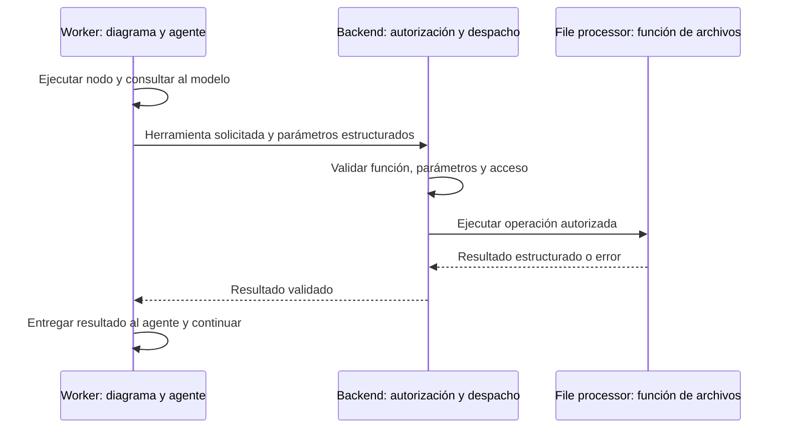

# Herramientas de archivos para agentes: arquitectura acordada


## Decisión para Trato

Usar **herramientas internas y llamadas HTTP propias, sin MCP en esta etapa**. El worker ejecuta diagramas y llamadas al modelo; el backend autoriza y canaliza las herramientas de archivos al procesador. El resultado vuelve por el mismo circuito. Esta es la arquitectura acordada para este bloque de Trato, no una afirmación de que todo el código ya siga ese diseño.

Para el compañero que continúa el proyecto: conservar este reparto al implementar nuevos nodos y coordinar las diferencias actuales listadas abajo antes de refactorizar. Gmail, PayPal y los estados de negocio permanecen en el backend.

## Recorrido



La solicitud de una herramienta no es ejecución de código generado por el modelo. Solo se despachan funciones previamente registradas, con entradas y salidas conocidas.

## Responsabilidades

- **`repos/trato-worker`:** diagramas, nodos, llamadas al modelo, herramientas disponibles para cada agente y continuación tras recibir resultados.
- **`repos/trato-api`:** validar llamadas, identidad, pertenencia a proyecto/documento y parámetros; resolver referencias internas; canalizar la operación al procesador y devolver el resultado al worker.
- **`repos/trato-file-processor`:** implementación y ejecución de funciones reutilizables de archivos. No decide permisos del usuario, no llama al agente ni ejecuta el diagrama.
- **Frontend oficial:** presenta estados y resultados a través del backend; no recibe credenciales internas del procesador.

Este reparto se aplica a las herramientas de archivos. No traslada Gmail, PayPal ni sus reglas de negocio al procesador.

## Herramienta propuesta

Nombre acordado como ejemplo de contrato: `search_text_file_id`.

```json
{
  "tool": "search_text_file_id",
  "params": {
    "file_ids": ["id-de-una-fuente-autorizada"]
  }
}
```

No es todavía un endpoint disponible. El backend deriva el ámbito desde la ejecución autorizada y comprueba cada ID; no confía en un propietario o proyecto elegido por el agente. El procesador recibe referencias resueltas o contenido autorizado según el contrato interno que se implemente, sin acceso administrativo general a documentos de otros usuarios.

La salida prevista contiene, por archivo, su ID, texto y localizadores de página/sección disponibles. Es una propuesta, no una ruta de archivo `_text` ni una nueva extensión que ya exista en Storage. La extracción actual devuelve campos de texto y segmentos; reutilizar ese resultado cuando esté guardado, sin volver a extraer el original en cada evaluación.

Antes de implementar, concretar cómo el procesador obtiene el texto persistido a través del backend manteniendo este circuito. No añadirle acceso directo irrestricto a Supabase para resolverlo. Validar tamaño, lista de IDs y formatos; un archivo ausente o no autorizado produce error explícito, no una búsqueda de otro documento como sustitución.

## Dos formas de invocar la misma función

1. Un nodo determinista del diagrama necesita leer archivos conocidos y solicita la operación, sin llamar primero a un LLM.
2. El agente solicita la herramienta mediante tool calling o una salida estructurada validada; el worker continúa por el nodo que llama al backend.

Ambas formas recorren backend → procesador → backend → worker. Las fuentes obligatorias de un evaluador deben obtenerse antes de permitir la evaluación; dejar una herramienta disponible no prueba que el agente la haya usado.

## Definiciones para el equipo

| Concepto | Qué significa en Trato |
| --- | --- |
| Función | Código previamente implementado que realiza una operación. |
| Herramienta del agente | Nombre, descripción y esquema que permiten al modelo solicitar una función. |
| Diagrama | Secuencia de nodos y decisiones ejecutada por el worker. |
| MCP | Protocolo opcional para descubrir y solicitar herramientas a un servidor compatible. |

El modelo **solicita**, no ejecuta la función por sí mismo. Cuando devuelve una llamada, el worker la valida y envía al backend; recibe el resultado y vuelve a consultar al modelo para continuar. Usar tool calling nativo o JSON estructurado no implica utilizar MCP.

Las herramientas habilitadas se seleccionan mediante configuración explícita del workflow. El worker entrega al modelo solo sus nombres, descripciones y esquemas; el prompt explica cuándo usarlas. No detectar una supuesta activación buscando palabras en el prompt ni permitir que un documento agregue herramientas.

### Qué cambiaría con MCP

El worker actuaría como cliente MCP y el backend podría exponer un servidor MCP. Ese protocolo aportaría descubrimiento, descripción, solicitud de ejecución y respuesta/error estandarizados. El backend seguiría autorizando y el procesador seguiría ejecutando las funciones de archivos.

Con las llamadas internas elegidas, nosotros definimos esos contratos y endpoints HTTP. MCP sería una ampliación a evaluar si otras aplicaciones necesitan consumir las herramientas mediante una interfaz estándar. No es necesario para reutilizar funciones dentro de Trato y no se presupone una mejora de velocidad. No activar una segunda vía automáticamente ante un fallo.

## Simplicidad documental

Para las guías de Ensayos, el equipo pidió no añadir una gestión de versiones nueva como requisito inicial. Trabajar con los archivos seleccionados, sus IDs y los localizadores existentes. Esta simplificación no elimina el historial contractual de adendas ya construido ni convierte subir un archivo en aceptación.

## Diferencias actuales que requieren coordinación

- La ingesta conectada del worker obtiene el original del backend y después invoca directamente al procesador. Adaptarla al nuevo circuito es trabajo pendiente, no realizado por escribir esta decisión.
- El adaptador local de Ensayos está provisionalmente en la API. Llevar la ejecución del agente al diagrama del worker forma parte de la integración pendiente.
- `search_text_file_id` no está implementada ni expuesta mediante MCP.
- El compañero humano conserva el recorrido contractual y devoluciones. No modificar sus handlers, contratos o ingesta en paralelo sin acordar el bloque exacto.

## Cierre esperado de la futura implementación

- Misma operación reutilizada por nodo determinista y por solicitud estructurada del agente.
- Acceso ajeno, parámetros inválidos y herramientas desconocidas rechazados antes de ejecutar.
- Resultado del procesador validado y asociado a la ejecución correcta.
- Error visible y estado conservado, sin proveedor, documento o transporte alternativo no autorizado.
- Agente del ensayo ejecutado por el worker y sin herramientas financieras disponibles.
- Pruebas que distingan doble de modelo, procesador real y recorrido integrado.

Referencias: [estándar de prompts](estandar-prompts.md), [fuentes y recuperación](fuentes-y-recuperacion-ensayos.md), [Tools de LangChain](https://docs.langchain.com/oss/python/langchain/tools), [arquitectura MCP](https://modelcontextprotocol.io/docs/learn/architecture).
