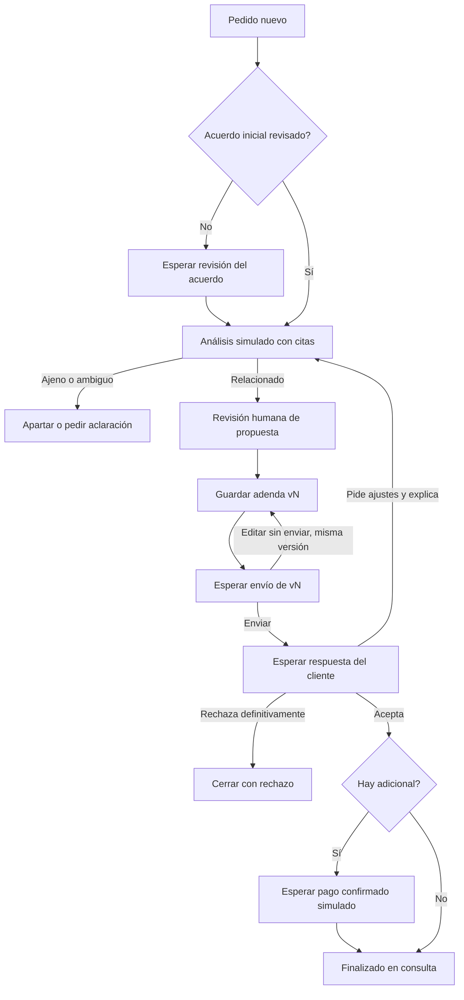

# Recorrido simulado de pedidos y revisiones

Implementado el 26 de octubre de 2026 en `repos/trato-worker/trato_worker/change_flow.py`. Usa el mismo sobre `thread`, con `workflow=manage_change`, LangGraph, checkpoints y pausas humanas persistentes. Es simulación explícita y aislada: no consume Gemini, no procesa fuentes reales ni guarda propuestas en Supabase; no genera PDFs, envía correos o cobra pagos reales.

## Qué hace

1. Registra el pedido dentro del contexto propietario/cliente/proyecto del thread.
2. Si el acuerdo inicial todavía no está revisado, se pausa para confirmarlo. El ejemplo usa una fuente inicial ficticia; esta confirmación no crea una aceptación contractual del cliente.
3. Compara las fuentes de acuerdo/pedido y devuelve clasificación, pedido explícito, alcance inicial, recomendación, citas y comentarios del cliente cuando existen. Esta decisión se elige mediante `fixture_id`, no mediante inferencia. Casos: adicional, incluido, ambiguo y ajeno. Ambiguo/ajeno quedan retenidos sin propuesta.
4. Se pausa para que el usuario revise alcance, importe, moneda, fecha y condiciones. El grafo no guarda una adenda automáticamente después del análisis.
5. Guarda un snapshot de adenda v1 con contenido/hash, fuentes y fecha. Es contenido JSON de prueba, sin PDF. Cada snapshot conserva sus datos y nunca se sobrescribe. Antes de enviar, `edit_draft` actualiza el borrador conservando `revision_id` y versión; incrementa sólo `draft_sequence` y añade una instantánea interna a `draft_snapshots`. `revisions` expone la instantánea vigente de cada versión, no una fila nueva por cada edición.
6. Se pausa para simular el envío de esa versión y luego la respuesta del cliente.
7. Si el cliente pide ajustes, exige `feedback_notes` y `feedback_document_id` (UUID de su respuesta), vuelve al análisis con esos comentarios y la revisión anterior y requiere una nueva validación del usuario. Al guardar nace v2; conserva v1. V2 requiere envío y aceptación propios.
8. Si el cliente acepta y hay adicional, espera confirmación de pago simulada. No hay cancelación/abandono de checkout en los estados del cambio. Si no hay adicional, termina al aceptar.
9. Tras finalizar queda en consulta. No puede reanudarse ni abrirse otro thread con el mismo request_id para modificarlo; los ajustes posteriores necesitan otra solicitud. El rechazo definitivo se conserva como otro final posible, distinto de pedir una revisión.



## Contrato de pausa y reanudación

`start` recibe `request_id` (UUID), `project_brief`, `fixture_id` y `baseline_reviewed` (booleano). El resultado devuelve `action=awaiting_review` y `result.pending`, con `stage`, `interrupt_id`, datos para revisar y acciones permitidas.

La respuesta mantiene thread/context/workflow, usa un `event_id` nuevo y sólo entrega la decisión del paso pendiente:

```json
{
  "action": "resume",
  "payload": {
    "interrupt_id": "id-devuelto-en-pending",
    "input": {"action": "confirm_baseline"}
  }
}
```

Lo anterior es un fragmento del sobre; los otros campos obligatorios del thread se conservan.

| Paso pendiente | Input |
| --- | --- |
| review_baseline | action=confirm_baseline |
| review_proposal | action=approve_proposal, scope, amount_cents, currency=USD, due_date (ISO), terms |
| send_revision | action=simulate_send, o action=edit_draft con los mismos campos de propuesta |
| client_decision | action=accept, request_revision o reject; feedback_notes y feedback_document_id obligatorios al pedir revisión |
| confirm_payment | action=simulate_verified_payment |

Editar invalida la pausa anterior: el envío posterior debe responder al interrupt_id de la instantánea actual. Los eventos de envío, respuesta y pago identifican también snapshot_id; el envío conserva el hash exacto. Las ediciones internas se marcan `internal=true` y no representan nuevas versiones para el cliente.

No se acepta un interrupt_id anterior ni una acción de otro paso. La validación ocurre antes de reanudar. Repetir el mismo event_id/cuerpo devuelve exactamente el resultado anterior, sin duplicar versiones. `get` con payload vacío consulta el estado; reenviar `start` no confirma una pausa.

Todos los eventos llevan `mode=simulation`; el resultado mantiene `provider_verified=false`. El nombre simulate_verified_payment describe una rama elegida de prueba, no una verificación de PayPal. No conectar esta orden a una API pública real ni usarla para acreditar pagos de negocio.

## Ejecutar ambos ejemplos

Desde `repos/trato-worker`:

```bash
PYTHONPATH=. .venv/bin/python examples/change-lifecycle.py
```

El script usa una base temporal propia y recorre proyecto existente y nuevo. En ambos guarda y edita v1 antes de enviar, simula comentarios con documento de respaldo, guarda y edita v2, vuelve a enviar, acepta v2 y simula pago. Conserva dos versiones y cuatro instantáneas internas. Imprime los eventos JSON. Usa fixtures declarados, nunca un fallback de un proveedor fallido.

La CLI genérica existente también acepta estos mensajes por stdio/Redis, incluidos `resume` y `get`. No se inició un Redis persistente ni se reutilizó el puerto 6379; la prueba de integración crea su servidor temporal independiente.

## Integración futura y prompts

`prompts/analyze-change.json` contiene la plantilla versionada conforme a `docs/estandar-prompts.md`: rol separado, contexto, checklist, pasos y formato con ejemplo. Define origen de los datos, citas, incertidumbre y valores null cuando no hay precio/fecha propuestos. Es una plantilla pendiente de conectar y validar con el esquema de inferencia real; el grafo simulado no la presenta como una llamada a un modelo.

La conexión real usará fuentes autorizadas, referencias de acuerdo aceptado y contratos de propuestas/revisiones de la API de P1, con sus controles de inmutabilidad, proyecto activo e idempotencia. En simulación sólo se valida el formato UUID de feedback_document_id; la API real deberá comprobar que el documento existe, pertenece al proyecto activo y respalda la respuesta del cliente. No se presenta esa referencia simulada como evidencia verificada. El backend persiste y acredita aceptación/pago; el worker no determina permisos, firma ni estado de PayPal. La recomendación corresponde a la vista de comparación; el historial permanece de consulta. No se cambiaron la interfaz conectada de 5173 ni los endpoints de correo/pago.

Aclarar un pedido retenido requiere incorporar fuentes/corrección y diseñar su siguiente comando en la integración real; esta entrega no sustituye un resultado ambiguo por un caso aceptado automáticamente.

## Verificación de esta entrega

### Correspondencia con las instantáneas reales de la API

P1 confirmó que editar un borrador conserva `revision_no`, pero crea una fila nueva de `proposal_revisions`, con UUID nuevo, `draft_sequence` incrementado y `replaces_draft_id` apuntando al borrador anterior. El `revision_id` estable de la simulación identifica la versión lógica; **no equivale al UUID de esa fila del backend**. La futura integración debe mapear cada `snapshot_id` simulado/de trabajo al UUID real de la instantánea persistida. `expected_revision_id` para CAS/envío debe usar ese UUID vigente, nunca el UUID reemplazado. No se ha implementado ese adaptador.

La API devuelve `revisions` como última instantánea por número visible y `snapshots` como todas las instantáneas. Para feedback real, `source_document_ids` debe incluir `feedback_document_id`, de tipo `reference` y del mismo propietario/proyecto. La validación UUID de la simulación no sustituye estas comprobaciones.

### Resultados

39 pruebas unitarias aprobadas (13 de ciclo de cambios) y 5 de integración con Redis real temporal. Incluyen reinicio, redelivery, revisiones inmutables, respuesta obsoleta, edición previa al envío idempotente, fuente de feedback obligatoria, bloqueo de edición después del envío, final pagado sin edición, revisión del acuerdo pendiente, rechazo, cierre sin adicional y reanudación por Redis. Los dos ejemplos completos terminaron con dos versiones conservadas.
