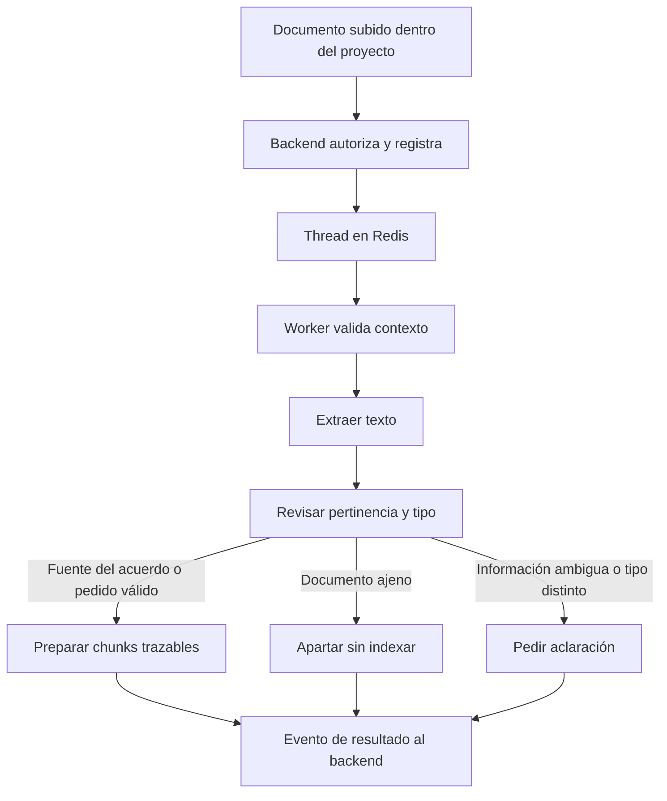

# Primera etapa: documento subido desde un proyecto

Actualización del 26 de octubre: este documento conserva la primera prueba aislada. Ya existe una ingesta PDF conectada por cola, descrita en [ingesta-conectada.md](ingesta-conectada.md). La pertinencia del contenido sigue sin inferencia real; sus fixtures permanecen separados.

Implementación de prueba aislada en `repos/trato-worker`. Modo `simulation` obligatorio. Gemini y la activación de Google Cloud quedan pendientes por decisión del usuario. Esta entrega se limita al documento; no ejecuta análisis de cambios, adendas, Gmail ni PayPal.

## Recorrido

1. El usuario elige un proyecto y sube una fuente inicial o un pedido. La API debe autorizar al propietario y derivar cliente/proyecto; los documentos pasan primero por revisión de ingesta.
2. La orden usa el sobre genérico `thread`, `workflow=ingest_document`, con IDs de propietario/cliente/proyecto/documento/extracción. `event_id` identifica la orden; `thread_id` identifica el recorrido persistente.
3. Redis entrega la orden al dispatcher del worker. La API HTTP no ejecuta el grafo.
4. El grafo valida el contexto técnico, obtiene el texto y revisa pertinencia y función del documento.
5. Sólo un documento pertinente y correctamente clasificado continúa a la preparación de chunks. Si es ajeno queda apartado; si es ambiguo o está clasificado de forma contradictoria, pide aclaración.
6. Cada chunk conserva los IDs anteriores, localizador real de su segmento, offsets y hash del texto. El resultado vuelve como evento `thread`.



## Validar incluso el primer archivo

Hay dos controles diferentes:

- **Pertenencia técnica:** propietario, cliente y proyecto autorizados; IDs estables del documento/extracción. No se permite mover un thread existente cambiando estos datos.
- **Pertinencia del contenido:** determinar si el documento sirve como fuente del acuerdo inicial (contrato o conversación) o como pedido nuevo de ese proyecto. Un archivo legible no se admite automáticamente como fuente útil.

La evaluación necesita contexto del proyecto (`project_brief` en este contrato de prueba), no sólo un UUID. Si no hay información suficiente, se solicita aclaración; no se puede garantizar pertinencia usando únicamente un nombre genérico como «Proyecto 1».

Un pedido nuevo válido puede guardarse aunque sea el primer archivo. Se señala que debe aportar el acuerdo inicial antes de compararlo, sin iniciar ese análisis durante la ingesta. Si el usuario lo subió como acuerdo inicial y se detecta un pedido, se pide confirmar la categoría en vez de reclasificar silenciosamente. Admitir una fuente no valida un contrato ni acredita aceptación/firma.

## Qué se ejecuta y qué se simula

- **Reales:** dispatcher genérico, LangGraph, etapa determinista de LangChain, fragmentación con offsets, SQLite para checkpoints/resultados, transporte Redis Streams, ACK y recuperación de pendientes.
- **Simulados explícitamente:** extracción y decisión de pertinencia a partir del caso `fixture_id`. No hay inferencia semántica real ni llamadas a Gemini. El selector de casos está en el mensaje de prueba, no en la interfaz conectada.
- Los casos incluyen fuente inicial, pedido, documento ajeno, documento ambiguo y archivo ilegible. Cada evento lleva `mode=simulation`.
- Los chunks aún no tienen embeddings ni están indexados en Weaviate (`index_status=not_indexed`). Los índices falsos o los vectores aleatorios no forman parte de esta prueba.
- No se modificó la carga conectada en 5173 ni su persistencia Supabase. Actualmente su ruta de subida sigue siendo síncrona. Esta prueba deja preparado y comprobado el recorrido del worker antes de migrar esa ruta.

El contexto del sobre debe proceder de una API confiable. La validación de UUID y la vinculación persistente no sustituyen la autorización contra los datos del proyecto. Este consumidor no es un endpoint público.

Al conectar la API real, también debe rechazarse un proyecto cuyo cliente esté archivado (`clients.deleted_at`), usando la guardia de dominio que prepara P1 (`private.ensure_active_project`). La comprobación se aplica al admitir una orden y antes de persistir sus resultados; un contexto previamente válido no autoriza escribir después de archivar el cliente.

## Ejecutar una prueba local explícita

Desde `repos/trato-worker`:

```bash
.venv/bin/python -m trato_worker.ingest --mode simulation --transport stdio < examples/document-upload.thread.json
```

El resultado incluye estado, etapas, pertinencia y chunks. Repetir la orden devuelve el mismo resultado guardado. Un mismo `event_id` con otro cuerpo se rechaza; un thread no admite reemplazar documento o contexto.

Para probar la cola, configurar `TRATO_SIMULATION_REDIS_URL` en el entorno del proceso. No se cambia automáticamente a stdio si Redis falla.

```bash
.venv/bin/python -m trato_worker.ingest --mode simulation --transport redis --publish < examples/document-upload.thread.json
.venv/bin/python -m trato_worker.ingest --mode simulation --transport redis --once
```

Streams separados del funcionamiento real: `trato:simulation:thread:commands` y `trato:simulation:thread:events`. Grupo `trato-simulation-workers`. Redis debe tener autenticación, persistencia y retención apropiadas antes de cualquier despliegue; los ACK no implican entrega exactamente una vez. El consumidor de resultados deduplicará por `event_id`.

SQLite y su lock entre procesos son para la prueba local en un disco compartido. No son un mecanismo de coordinación entre instancias distribuidas de Render. Esa conexión y la outbox transaccional del backend son parte de la migración posterior acordada, no implementaciones ocultas en esta entrega.

## Verificación

```bash
.venv/bin/python -m unittest discover -s tests -v
TRATO_RUN_REDIS_TESTS=1 .venv/bin/python -m unittest discover -s tests -p test_ingestion_redis.py -v
```

La integración inicia y apaga su propia instancia temporal de Redis; no utiliza la instancia de la aplicación. Comprueba progreso/resultado, redelivery idempotente, recuperación de consumidor caído y rechazo de órdenes reales en el modo de simulación. Las pruebas de ingesta comprueban fuente inicial, primer pedido válido, categoría contradictoria, archivo ajeno/ambiguo, error de lectura, aislamiento de contexto y reinicio del proceso.
